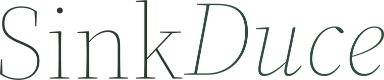

<div align="center">




$$\text{\textbf{Spark. Sink. Educe.}}$$

*An intelligent, context-isolated personal memory system — meetings, notes, and files in project Collections, with RAG chat and an MCP server.*

[](LICENSE)
[](https://www.python.org/)
[](https://react.dev/)
[](https://www.docker.com/)
[](https://modelcontextprotocol.io/)

[Quick start](#quick-start) · [How it works](#how-it-works) · [Features](#features) · [MCP](#mcp) · [Stack](#stack)

</div>

SinkDuce is a self-hosted **RAG knowledge system** for personal and project memory. Deploy it as a macOS application or with Docker. Meetings, notes, and documents are stored in isolated **Collections**; questions are answered with citations back to the original source. The same library is exposed as an **MCP server** so editors such as Cursor can search and update it.

LLM, embedding, and speech can use cloud APIs or **local models** (Ollama, LM Studio, vLLM, on-device ONNX ASR), so the stack can stay on your machine when you want it to.

**Spark** (capture) → **Sink** (organize) → **Educe** (reason).

**v1.3.0:** **PREPARE** — attendee profiles + a one-page pre-meeting brief; **live summary** and **live translation** (bilingual captions) while recording; **meeting group chat** across follow-ups; **zh-CN / English UI**.

**v1.2.0:** macOS desktop (Apple Silicon DMG) on the same GitHub Release as the Docker image; **speaker matching** — enroll a person once, later meetings suggest the same name.

---

## Quick start

### macOS (Apple Silicon)

1. Download **[SinkDuce-macos-arm64-v1.4.0.dmg](https://github.com/superdd-coder/sinkduce/releases/download/v1.4.0/SinkDuce-macos-arm64-v1.4.0.dmg)** from the [v1.4.0 Release](https://github.com/superdd-coder/sinkduce/releases/tag/v1.4.0).
2. Open the disk image and drag **SinkDuce** into Applications.
3. First launch: right-click → **Open** (ad-hoc signed; Gatekeeper may warn).
4. After an update: **Cmd+Q** then reopen — the red window button only hides to the menu bar.

Data: `~/Library/Application Support/SinkDuce`. API and MCP: `127.0.0.1:18910` (or the next free port).

Then: Settings → add an **LLM** and **Embedding** provider (or OneShot below) → create a Collection.

### Docker

```bash
git clone https://github.com/superdd-coder/sinkduce.git
cd sinkduce
docker compose pull && docker compose up -d
```

Open [http://localhost:18900](http://localhost:18900). From source: `docker compose -f docker-compose.build.yml up -d --build`. Other layouts: [`deploy/README.md`](deploy/README.md).

```bash
git pull && docker compose pull && docker compose up -d
```

`data/` (library, config, meetings, notes, models) stays on the volume.

> [!TIP]
> **DashScope / OpenRouter OneShot** — Settings → LLM Providers. One API key can set up LLM, embedding, rerank, vision, and transcription.
>
> **Offline speech** — Settings → Local Models → Download local models (ONNX pack from this repo’s GitHub Releases).
>
> **MinerU (optional)** — token from [mineru.net](https://mineru.net/apiManage/token); enable per Collection. Falls back to local parsers.

---

## How it works

### Spark — capture

**Meetings:** mix-record mic + system audio, or upload a file; pause and discard are supported. Transcribe with **local ONNX** or cloud ASR. You get a general summary and **Blueprint sections** aligned with your Collections; edit, then ingest. Click a summary sentence to jump to the transcript and play audio. Summaries can be translated and exported.

**Before the meeting (PREPARE):** pre-select attendees and jot the agenda; SinkDuce distills a **person profile** from every past meeting and synthesizes a **one-page brief** around your agenda — who is joining, open todos, and what happened last time.

**During the meeting:** realtime captions, plus a **live summary** (key points / decisions / questions / action items updated as you talk) and **live translation** — bilingual captions via an end-to-end simultaneous-translation model; toggle it or switch target language mid-recording without interrupting capture.

**Speaker matching (v1.2.0):** keep a people library. After a meeting, the app suggests who is talking so you do not rename speakers every time.

**Notes:** Tiptap editor per Collection (auto-save). Dual-pane editing, distill a note into a citation, propagate when the source changes, one-click ingest. Open a meeting summary beside a note in the same workspace.

**Files:** PDF, Office, Markdown, HTML, CSV, images, and more (OCR included). Optional MinerU for hard layouts. Library supports whole-folder upload.

### Sink — organize

Everything lives in a **Collection**, isolated by project or theme.

**Library** is the working surface for that material:

- **Folders** — browse, versions, move / archive, list or grid view, file preview.
- **Timeline** — chains and nodes for how work evolves; attach files, messages, and todos.

Mark **Definitive** sources for collection overviews and **conflict** compare (side-by-side). Chunking is sentence- and Markdown-aware; parent-child chunks and contextual enrichment are optional.

### Educe — reason

**Chat:** pick one or more Collections, switch model per turn, streamed answers with a thinking / retrieval timeline. Open sources from snippet → document → original file. Complex questions use an agentic path; simpler ones a direct retrieve. Optional **web search** only after you confirm.

**Meeting chat:** ask follow-up questions right inside a meeting — Quick Chat looks up its transcript, and a **group chat** spans a series of follow-up meetings with citations back to each one.

**Quick Chat** sits next to Library or a meeting. **Recall** is there if you want to evaluate retrieval. The same memory is exposed as **MCP** so it is not locked in the web UI.

---

## Features

| Area | What you get |
|------|----------------|
| **Meetings** | Mix-record or upload → transcribe (local or cloud) → summary + topic sections → ingest. Sentence-level jump-back, speakers, hot words, language hints, translate / export. **Speaker matching** across meetings. |
| **PREPARE** | Pre-select attendees, write the agenda; **person profiles** distilled from past meetings; **one-page pre-meeting brief** (attendees + open todos + last-time recap). |
| **Live meeting** | Realtime captions with **live summary** (points / decisions / actions) and **live translation** — bilingual captions, toggled or re-targeted mid-recording. |
| **Notes** | WYSIWYG editor (Markdown, tables, images, tasks). Distill, propagate citations, ingest (OCR + vision on images). |
| **Library** | Folders, versions, timeline (chains / nodes), messages, smart todos. Move / archive, list or grid view. Definitive flag, collection overview, conflict compare. |
| **Ingest** | Common office / web formats + OCR; optional MinerU. Images described for search. |
| **Chat** | Multi-collection Q&A, visible steps, 3-layer sources, in-chat model switch. Optional confirmed web search. Quick Chat + Recall, **meeting group chat** across follow-ups. |
| **Setup** | OneShot for DashScope / OpenRouter. Separate models for chat, vision, and meeting summary. Local ONNX ASR download in Settings. zh-CN / English UI. |
| **MCP** | 65 tools on the same process (loopback only) — collections, files, search, meetings, notes, hot words, tasks, plus **Hub** tools to reach other boxes. |

---

## MCP

MCP runs on the same process as the API, over **loopback only** — an agent on this machine
can reach it, and nothing on the network can. Start SinkDuce first, then point the client
at it:

```json
{
  "mcpServers": {
    "sinkduce": {
      "type": "http",
      "url": "http://127.0.0.1:18900/mcp"
    }
  }
}
```

No key is involved: loopback means "this machine", so the agent is the owner, exactly like
the app's own frontend. Settings → MCP generates this JSON for you, with the right port
(the desktop app usually binds `18910`).

**This box is also a Hub.** An agent connected here can see the other boxes this install is
linked to via `list_boxes` / `switch_box`, and search them all at once with
`search_all_boxes`. It never needs their keys: this box holds them and proxies the calls.

There is deliberately **no remote/LAN MCP**, and a pairing key does not open it — a request
to `/mcp` from another host is refused, in a way that does not reveal the endpoint exists.
To work with another box, run the agent on that box and connect to its own MCP there.

| | URL |
|---|-----|
| Docker | `http://127.0.0.1:18900/mcp` |
| Desktop | the port the app bound — usually `http://127.0.0.1:18910/mcp` |

| Domain | Tools | For |
|--------|------:|-----|
| Collections | 5 | List, create, config, delete |
| Documents | 6 | List, upload, text, chunks, definitive |
| File management | 17 | Library tree, timeline, folders / files / versions, upload |
| Search | 3 | Direct retrieve, agentic retrieve, history |
| Tasks | 5 | List, status, cancel, retry |
| Summaries | 4 | Overview, doc summary, conflicts, consolidate |
| Notes | 6 | CRUD + propagate |
| Meetings | 11 | CRUD, transcript, summary, audio |
| Hot words | 5 | Libraries and terms |
| Hub | 3 | List boxes, switch the current box, search every box at once |

---

## Stack

| | |
|---|---|
| App | Python 3.11, FastAPI, React 19, Vite, Tailwind, Zustand, Tiptap |
| Search | Qdrant (dense + BM25 hybrid), OpenAI-compatible LLM / embedding / rerank (Cohere, DashScope, …) |
| Parse & speech | pdfplumber, Office parsers, RapidOCR; optional MinerU; FunASR ONNX (local) or cloud ASR |
| Ship | Docker Hub `jethrohou/sinkduce` (`linux/amd64` + `linux/arm64`); macOS desktop via Tauri (same app) |

---

SinkDuce, including the retained `ee/` modules, is **[AGPL-3.0-or-later](LICENSE)** and may be used by individuals or organizations without user, device, API Key, or Collection limits. Third-party notices: [THIRD_PARTY_NOTICES.md](THIRD_PARTY_NOTICES.md).

The public Docker and macOS builds are full-feature Community distributions, including custom roles, domain and Collection access rules, and device-key role management. Existing implementations remain under `ee/` and the frontend edition adapters so future distribution splitting can reuse those boundaries. From source, `docker compose -f docker-compose.build.yml up -d --build` builds full Community. The internal Enterprise assembly remains available through `SINKDUCE_EDITION=enterprise`; a direct image build uses `docker build --target enterprise .`.

Full Community loads existing role, ACL, and device-key records without rewriting them. Normal upgrades keep those rules. The retained `scripts/migrate_enterprise_to_community.py` utility targets the older restricted core profile and removes permission isolation when explicitly applied; it is unnecessary for a full Community upgrade.

### Edition development commands

Run these from the repository root. The default full Community build supports existing custom roles and ACL data. Back up runtime data before a normal upgrade; use separate data and ports for development checks.

```bash
SINKDUCE_EDITION=community docker compose -f docker-compose.build.yml up -d --build
docker compose -f docker-compose.build.yml exec app cat /app/edition.json
```

For side-by-side development, use separate Compose projects, data directories, and ports. These commands leave the `18900` deployment and its `data/` untouched:

```bash
SINKDUCE_EDITION=community SINKDUCE_DATA="$HOME/.sinkduce-dev/community" \
  API_PORT=18930 EXTERNAL_PORT=18931 \
  docker compose -p sinkduce-dev-ce -f docker-compose.build.yml up -d --build

SINKDUCE_EDITION=enterprise SINKDUCE_DATA="$HOME/.sinkduce-dev/enterprise" \
  API_PORT=18940 EXTERNAL_PORT=18941 \
  docker compose -p sinkduce-dev-ee -f docker-compose.build.yml up -d --build
```

Open Community at `http://127.0.0.1:18930` and Enterprise at `http://127.0.0.1:18940`. For frontend hot reload, run one of these from `frontend/` and restart Vite when switching editions:

```bash
SINKDUCE_EDITION=community API_PORT=18930 UI_PORT=5175 pnpm dev
SINKDUCE_EDITION=enterprise API_PORT=18940 UI_PORT=5176 pnpm dev
```

To stop a development stack, use `docker compose -p sinkduce-dev-ce -f docker-compose.build.yml down` or the same command with `sinkduce-dev-ee`. Bind-mounted development data remains in `~/.sinkduce-dev/`. For local macOS trial packages, use `SINKDUCE_PACK_DEV=1 SINKDUCE_EDITION=community ./desktop/package_macos.sh` or replace `community` with `enterprise`. The editions produce separate `SinkDuce` and `SinkDuce-EE` app and DMG names and use separate macOS data directories, so they can run together. Enterprise in-app updates stay disabled until a separate release channel exists.

[中文文档](README_CN.md)
